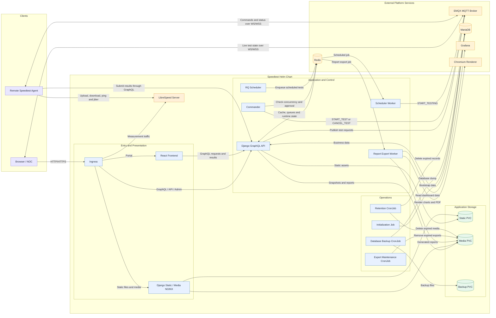

# SVTECH Centralized Speedtester

Helm chart for the application-owned parts of SVTECH Centralized Speedtester. It deploys the Django control plane, React portal, MQTT Commander, scheduler workers, LibreSpeed server, reporting workers, application storage claims, and ingress routes.

MariaDB, Redis, EMQX, Grafana, Chromium, and the storage provisioner are external infrastructure and are not created by this chart.

## Template Layout

Templates are grouped by runtime responsibility. Helm renders these directories recursively.

```text
templates/
├── auth/          # Database, MQTT, and Django bootstrap Secret
├── backend/       # Django API, static server, Service, and DB Secret
├── commander/     # MQTT Commander workload
├── frontend/      # React frontend workload and Service
├── networking/    # Application ingress routes
├── operations/    # Bootstrap, database backup, and retention jobs
├── reporting/     # Report export worker and maintenance CronJob
├── scheduler/     # RQ scheduler and execution worker
├── storage/       # Application PVCs
└── test-server/   # LibreSpeed workload and Service
```

## Component Purposes

| Component | Purpose |
|-----------|---------|
| Frontend | React portal for local and remote tests, administration, history, reports, and MQTT live state. |
| Django backend | GraphQL/API/admin control plane for authentication, tenancy, RBAC, configuration, result persistence, SLA evaluation, and report requests. |
| Django static | Nginx service for Django static files, uploaded media, test snapshots, and generated reports. |
| Commander | MQTT control process that checks Redis-backed concurrency and agent approval before publishing `START_TEST` or `CANCEL_TEST`. The legacy values and workload names use `mqttLogger` and `mqtt-logger`. |
| Scheduler | RQ Scheduler process that materializes saved site and site-group cron schedules. |
| Scheduler worker | Executes scheduled jobs and publishes test requests through MQTT. |
| Test server | LibreSpeed Go endpoint that handles upload, download, ping, and jitter measurement traffic. |
| Report export worker | Consumes the `report_export` RQ queue, renders charts/documents, and writes output to media storage. |
| Report maintenance | Removes expired exports and handles stale export jobs. |
| Init-data job | Creates initial application users, settings, and test-server data when explicitly enabled. |
| Backup job | Creates MariaDB backups and removes backups older than the configured retention period. |
| Retention job | Removes expired tenant results, SLA history, snapshots, and related media. |
| Ingress | Routes frontend, GraphQL/API/admin, static/media, and LibreSpeed paths. |
| Storage claims | Provide shared storage for static files, media, operational logs, and database backups; frontend builds use per-Pod temporary storage. |

Remote `speedtest-agent` instances run at monitored sites and are intentionally outside this central chart.

## Speedtest Deployment and Operational Flow

The following diagram describes how the Speedtest components are deployed and communicate in Kubernetes. It represents this Helm chart and may differ from the upstream application's development architecture.




## Prerequisites

- Kubernetes 1.29 or newer and Helm 3.14
- An ingress controller
- External MariaDB reachable through `db.host` and `db.port`
- External Redis reachable through `redis.host` and `redis.port`
- EMQX with MQTT over WS/WSS matching `mqtt` and `vite` settings
- Grafana endpoints required by the application dashboards
- Chromium CDP endpoint when report chart rendering is enabled
- A suitable Kubernetes StorageClass for each application PVC


## Important Configuration

- `global.frontendVip`: public IP address or hostname used by application URLs.
- `global.enableHttps`: switches generated public URLs between HTTP and HTTPS.
- `global.speedtest.runInitDataJob`: enables the one-time initialization job for creating default users, settings, and test-server data.
- `timezone`: container timezone; `global.timezone` overrides it when set.
- `replicaCounts`: replica settings for application workloads.
- `image`: image registry, repository, and tag for each application component.
- `pvc`: claim name, StorageClass, and capacity for application file storage.
- `db`, `mqtt`, `django`: independent password/Secret references for each credential.
- `db`: external MariaDB connection and managed-Secret source values.
- `redis`: external Redis connection used for runtime state, caching, channels, and RQ.
- `mqtt`: external EMQX connection, Commander limits, and managed-Secret source values.
- `vite`: browser-visible MQTT and frontend build settings.
- `django`: Django, multi-tenant, reporting, and bootstrap settings.
- `paths`: ingress and frontend path prefixes.

## Credential Secrets

Each credential has independent `password`, `existingSecret`, and
`existingSecretPasswordKey` values. A Pod can read multiple Secrets; credentials
are never copied from a producer Secret into an application Secret.

- `django`: self-owned bootstrap password. An empty
  password generates 32 random characters using `common.secrets.passwords.manage`.
  The managed Secret renders even when init-data is disabled, so disabling the
  Job on upgrade preserves the password for later retrieval. An external
  `django.auth.existingSecret` still suppresses local Secret creation.
- `db` and `mqtt`: external service credentials. Supply `existingSecret`, or an
  explicit password matching the account already provisioned at the service. Empty
  password + empty existingSecret fails rendering; Speedtest cannot provision an
  external MariaDB or MQTT account by inventing its own password.
- `existingSecret` takes precedence over password and suppresses creation of that
  group's Secret. All workloads use `secretKeyRef` for passwords. Host, port,
  database name, username, and bootstrap email remain ordinary values.

Example: Django owns its superuser password, while MariaDB and EMQX own theirs:

```yaml
global:
  speedtest:
    runInitDataJob: true
django:
  auth:
    username: admin
    password: ""  # Generated once; no shared producer.
  superUserEmail: admin@example.com
db:
  auth:
    username: speedtest
    existingSecret: mariadb-app-auth
    existingSecretPasswordKey: mariadb-password
mqtt:
  auth:
    username: admin
    existingSecret: emqx-mqtt
    existingSecretPasswordKey: MQTT_BROKER_PASSWORD
```

For a release named `emqx`, the EMQX chart's default managed MQTT Secret is
`emqx-mqtt`. Install both charts in the same namespace. For another release name
or fullname override, use the actual name rendered by that chart. Install EMQX
first, then Speedtest. Both sides must also use the same MQTT username.

For externally managed credentials, create one Secret separately, then point `speedtest.mqtt.auth.existingSecret` and
`emqx.mqtt.auth.existingSecret` at it with the same password key. Only the owner creates
that value. Changing a Secret alone does not change an existing database/MQTT user;
rotate the service account and restart consumers together.

## Application Paths

| Value | Default purpose |
|-------|-----------------|
| `paths.userPortal` | React portal |
| `paths.adminPortal` | Django admin |
| `paths.backendApi` | Backend REST endpoints |
| `paths.backendGraphQl` | GraphQL endpoint |
| `paths.staticDjango` | Django static files |
| `paths.mediaDjango` | Uploaded files, snapshots, and reports |
| `paths.speedtestServer` | LibreSpeed endpoint |


## Installation

Only one Speedtest release per namespace is supported: Service names are fixed.
Supply DB/MQTT credentials (or existing Secret references), and Django username/email
when init-data is enabled. Save these inputs in a private overlay before installing:

```sh
helm upgrade --install speedtest . --namespace speedtest --create-namespace \
  -f /etc/svtech/speedtest-values.yaml --timeout 35m --wait
```

Validate the release:

```sh
helm lint . -f ci/values.yaml
helm template speedtest . -f ci/values.yaml
kubectl get pods,svc,ingress,pvc -n speedtest
```


## Uninstall

```sh
helm uninstall speedtest --namespace speedtest
```

PVC retention depends on the StorageClass reclaim policy. Verify backups before manually deleting claims.

## Password and application setup checklist

When installing this chart alone:

1. Set `db.host`, `db.port`, `db.name`, and `db.auth.username` to the existing
   MariaDB endpoint/schema/account. Set `db.auth.existingSecret` to the actual
   Secret name; the current default `avc` is only a placeholder.
2. Set `mqtt.brokerHost`, `mqtt.brokerPort`, `mqtt.brokerPath`, and
   `mqtt.auth.username`. Replace the Secret name with the
   EMQX producer Secret. These are server-side connection settings.
3. Set `django.auth.username` and `django.superUserEmail`. Enable
   `global.speedtest.runInitDataJob` for initial application provisioning.
4. Set `django.allowedHosts`, `django.csrfTrustedOrigins`, tenant settings,
   storage classes under `pvc`, and browser MQTT settings under `vite` for your
   environment. Browser host/protocol/port must be reachable from the browser.

For an explicit password instead of an existing Secret, clear the reference:

```yaml
db:
  auth:
    username: speedtest
    password: "REPLACE_WITH_CURRENT_DB_PASSWORD"
    existingSecret: ""
mqtt:
  auth:
    username: admin
    password: "REPLACE_WITH_CURRENT_MQTT_PASSWORD"
    existingSecret: ""
django:
  auth:
    username: admin
    password: "" # Auto-generate; or provide the initial admin password.
    existingSecret: ""
```
The CI fixture is for rendering only; it does not provision external DB/MQTT
accounts and must not be used as production credentials. Default values alone
intentionally fail when required credentials are absent.

## Migration markers and backup maintenance

Migrations still run once per release revision using the application's existing
`backup-and-migrate.sh`. Marker files now live on the backup PVC, outside public
static storage. Django, the report worker, and init-data mount that PVC read-only
for their wait step. The backup PVC must support RWX across their nodes.

`migration.markerHistory` (default 10) retains recent revision markers. Cleanup
runs after successful collectstatic; it does not remove newer revision markers.
Recreating Pods from revisions outside that history may wait for a deleted
marker: deploy the desired image in a new upgrade to run a fresh migration Job.
Moving markers does not remove old `.speedtest/` files from the static PVC;
remove those only after old workloads no longer need them. Do not delete either
PVC as part of this change.

Configure `backup.schedule` (default `0 2 * * *`), `backup.retentionDays` (90), and
`purgeRetention.schedule` (`0 3 * * *`). Retention uses `find -mtime +N` and removes
only `.sql` backups. Monitor storage usage; retention by age is not a size limit.

An empty `vite.mqttBrokerHost` uses the browser's page hostname in the frontend
application. An empty `django.reportChartBackendBaseUrl` leaves report export
using only its frontend origin; set it when a separate backend cookie origin is
needed. These fallbacks belong to the application, not Helm.
